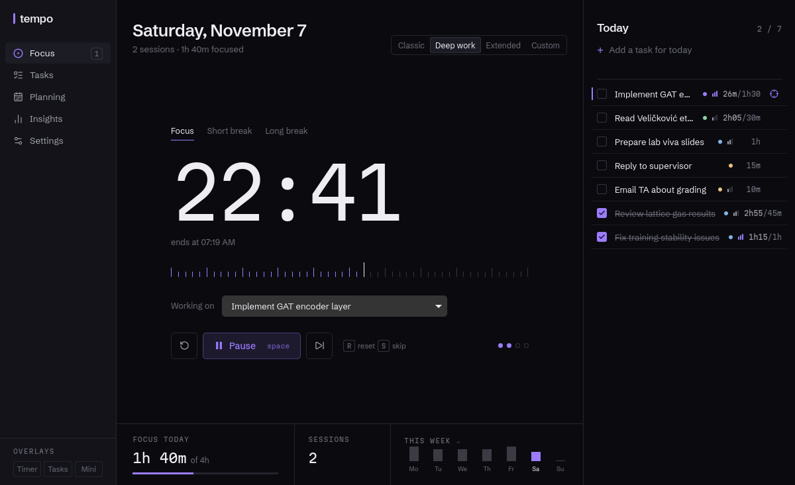
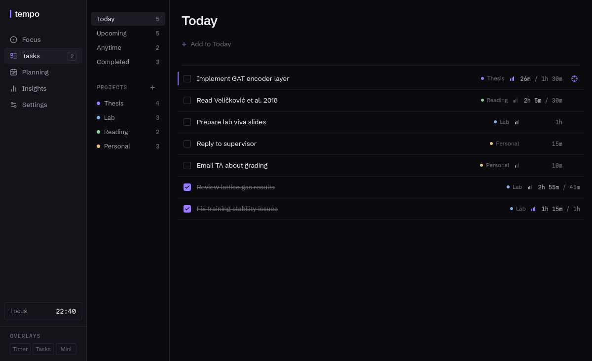
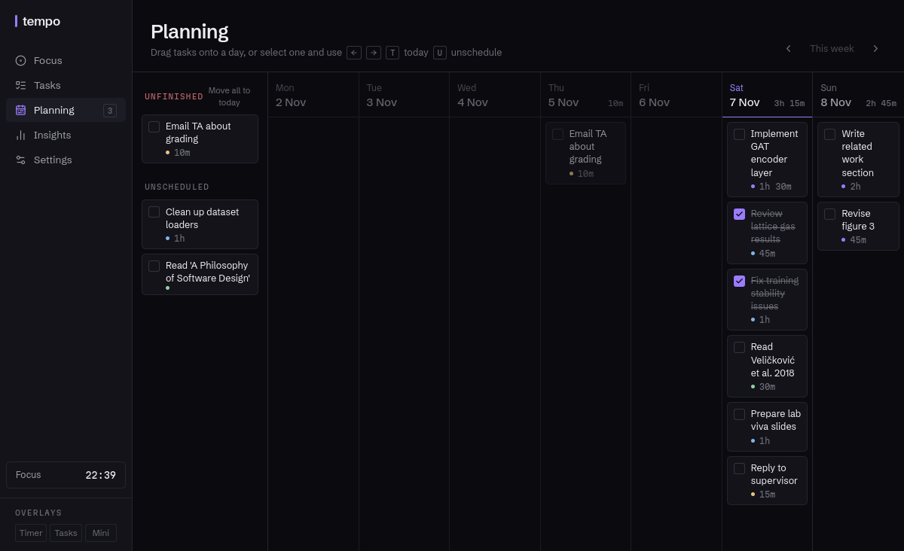
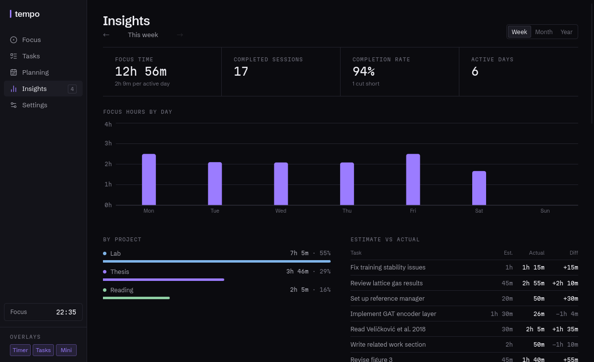
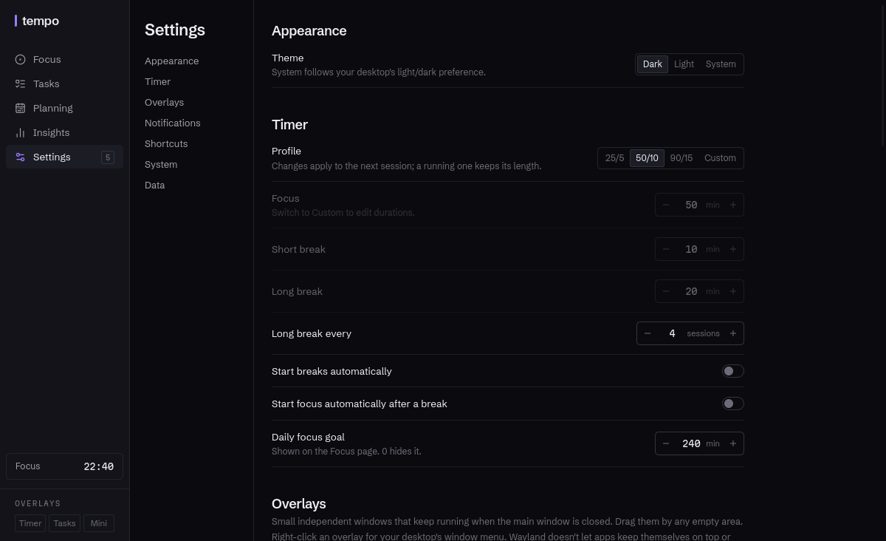
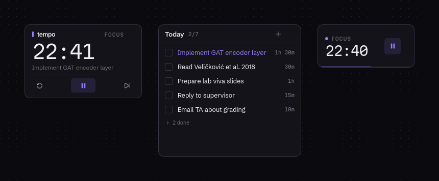
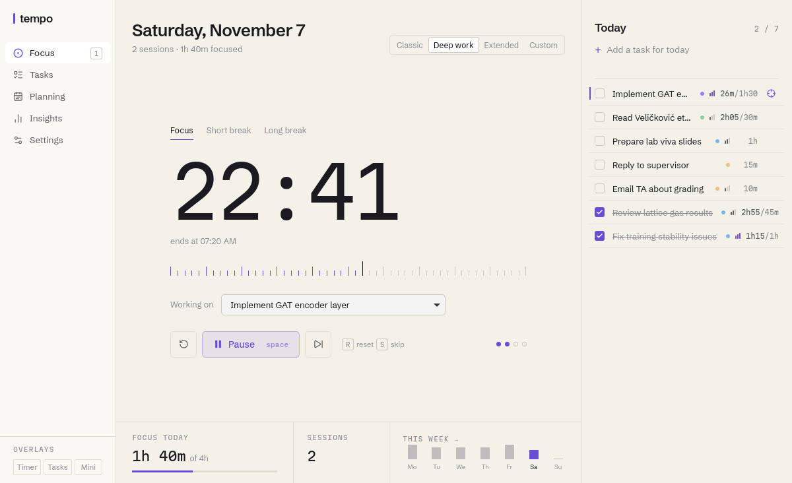

<div align="center">

# tempo

**A quiet Pomodoro timer and task list for the desktop.**

Local-first · keyboard-first · tiny overlays that stay out of the way

[](https://github.com/prasang06/tempo/actions/workflows/build.yml)
[](LICENSE)


[Download](#install) · [Features](#features) · [Keyboard](#keyboard) · [Build from source](#build-from-source)



</div>

## Why tempo

Most focus apps either do too little (a timer and nothing else) or far too much
(accounts, streaks, cloud sync, a dashboard you have to manage). tempo sits in between:

- **It's a desktop app, not a website.** It lives in your tray, sends native
  notifications, and answers to global shortcuts.
- **The timer is always right.** It runs in the Rust backend from wall-clock
  timestamps, so closing the window, reloading, restarting or putting your laptop to sleep
  doesn't lose or drift time.
- **It stays out of the way.** Close the main window and keep a 190×85 timer in a corner.
- **Your data is a file on your disk.** No account, no telemetry, no network access needed.

## Features

<table>
<tr>
<td width="50%"></td>
<td width="50%"></td>
</tr>
<tr>
<td><b>Tasks</b>. Today, Upcoming, Anytime, Completed and per-project views. Each task has
notes, priority, an estimate, a scheduled day and a due date, and records the focus time
spent on it.</td>
<td><b>Planning</b>. A week board. Drag tasks onto days or move them with the keyboard.
Unfinished tasks from earlier days are gathered up so you can move them forward in one go.</td>
</tr>
<tr>
<td></td>
<td></td>
</tr>
<tr>
<td><b>Insights</b>. Focus hours by day or month, where time went by project, estimates
against reality, and the full session history. No streaks or badges.</td>
<td><b>Settings</b>. Timer profiles, overlays, notifications, rebindable global shortcuts,
start on login, and JSON export/import.</td>
</tr>
</table>

### Overlays



Three small windows that work on their own, even with the main window closed: a
**floating timer**, a **quick tasks** list, and a **mini session** strip. Each one
remembers its own visibility, position, size, opacity and always-on-top setting. Drag them
anywhere; right-click for the window menu.

### Timer

| Profile | Focus | Break | Long break |
|---|---:|---:|---:|
| Classic | 25 min | 5 min | 15 min |
| Deep work | 50 min | 10 min | 20 min |
| Extended | 90 min | 15 min | 30 min |
| Custom | you choose | you choose | you choose |

A long break comes after a set number of focus sessions (4 by default). Breaks and the next
focus session can start on their own. Link a task to a session and its focus time is
tracked against the estimate.

### Quick add

Type everything on one line:

```
Write intro ~45m !h #thesis @tomorrow
```

| Token | Meaning |
|---|---|
| `~45m` `~1h30` | estimate |
| `!h` `!m` `!l` | priority |
| `#name` | project (created if it doesn't exist) |
| `@today` `@tomorrow` `@fri` `@2026-12-01` | scheduled day |

### Light theme



## Install

Get the latest version from **[Releases](https://github.com/prasang06/tempo/releases/latest)**.

| Platform | File | How |
|---|---|---|
| Windows 10 / 11 | `tempo_x.y.z_x64-setup.exe` | Run it. Installs for your user, no admin needed. |
| Windows (managed) | `tempo_x.y.z_x64_en-US.msi` | For deploying across machines. Needs admin. |
| Ubuntu / Debian | `tempo_x.y.z_amd64.deb` | `sudo apt install ./tempo_*.deb` |
| Fedora / openSUSE | `tempo-x.y.z-1.x86_64.rpm` | `sudo dnf install ./tempo-*.rpm` |
| Any Linux | `tempo_x.y.z_amd64.AppImage` | `chmod +x tempo_*.AppImage && ./tempo_*.AppImage` |
| Arch Linux | [`packaging/arch/PKGBUILD`](packaging/arch/PKGBUILD) | `cd packaging/arch && makepkg -si` |

<details>
<summary><b>Windows: the "Windows protected your PC" warning</b></summary>

The installers aren't code-signed yet, so SmartScreen warns about them. Click **More
info → Run anyway**. After installing, Windows may hide the tray icon: click the **^** arrow
in the taskbar and drag tempo's icon out.

tempo needs Microsoft Edge WebView2. Windows 10 (since 2021) and 11 already have it, and
the setup `.exe` installs it if it's missing.

Uninstall from Settings → Apps. Your data stays in `%APPDATA%\dev.tempo.app` until you
delete that folder.
</details>

<details>
<summary><b>Arch: why the package is called <code>tempo-focus</code></b></summary>

The AUR already has a `tempo` package (Grafana Tempo). The package is named `tempo-focus`
and conflicts with it; the command you run is still `tempo`. Runtime dependencies are
`webkit2gtk-4.1 gtk3 libayatana-appindicator`.
</details>

## Keyboard

| Where | Keys |
|---|---|
| Anywhere | `1`–`5` switch section · `?` show all shortcuts |
| Focus | `Space` start / pause · `R` reset · `S` skip · `N` new task |
| Task lists | `J` `K` move · `X` done · `F` focus on it · `E` edit · `Alt+↑↓` reorder · `Del` delete |
| Planning | `←` `→` move a day · `T` today · `U` unschedule · `[` `]` change week |

**Global shortcuts** (rebind them in Settings → Shortcuts, which also flags any that
another app has taken):

| Default | Action |
|---|---|
| `Ctrl+Alt+T` | Show / hide floating timer |
| `Ctrl+Alt+Q` | Show / hide quick tasks |
| `Ctrl+Alt+P` | Pause / resume |
| `Ctrl+Alt+N` | New focus session |
| `Ctrl+Alt+O` | Always-on-top for open overlays |
| `Ctrl+Shift+Space` | Open tempo |

### Command line

A running tempo takes commands from a second launch. That's how shortcuts work on Wayland,
and how to drive it from scripts, AutoHotkey, a Stream Deck, or a launcher:

```sh
tempo --action pause-resume    # new-focus · toggle-floating · quick-tasks
                               # mini-session · toggle-on-top · open-main
tempo --page insights          # focus · tasks · planning · insights · settings
tempo --hidden                 # start in the tray
```

- **KDE**: System Settings → Shortcuts → Add New → Command
- **GNOME**: Settings → Keyboard → Custom Shortcuts
- **Hyprland**: `bind = CTRL ALT, P, exec, tempo --action pause-resume`
- **Windows**: `"%LOCALAPPDATA%\tempo\tempo.exe" --action pause-resume`

On Linux, right-clicking the tempo launcher shows the common actions too.

## Platform support

| | Linux X11 | Linux Wayland | Windows 10/11 |
|---|:---:|:---:|:---:|
| Timer, tasks, planning, insights | ✓ | ✓ | ✓ |
| Overlays | ✓ | ✓ | ✓ |
| Overlays reopen where you left them | ✓ | compositor decides | ✓ |
| Always-on-top | ✓ | via right-click window menu | ✓ |
| Global shortcuts | ✓ | via `tempo --action` | ✓ |
| Tray | ✓ | ✓ | ✓ |
| Notification sound | sound theme | sound theme | Windows sounds |

<details>
<summary><b>Linux notes</b></summary>

- **Wayland positioning.** Wayland apps can't place their own windows or read where they
  are, so the compositor decides where overlays open. A KDE window rule, or a Hyprland
  `windowrulev2` on the titles `tempo — timer`, `tempo — tasks` and `tempo — mini`, can
  pin them.
- **Wayland always-on-top.** Apps can't keep themselves above other windows. Right-click an
  overlay to open your compositor's window menu. On KDE that has **Keep Above Others**; a
  window rule with "Keep above other windows: Force" makes it permanent.
- **Wayland shortcuts.** Apps can't grab keys globally, so built-in shortcuts only work
  while a tempo window has focus. Bind `tempo --action …` in your desktop instead.
- **Tray.** Works on KDE and most panels. Stock GNOME needs the *AppIndicator and
  KStatusNotifierItem Support* extension. With no tray, closing the window quits tempo so
  it never gets lost.
- **Sound** comes from your notification server and sound theme (default `complete`).
- **See-through overlays** need a compositor; without one they're drawn solid.
</details>

<details>
<summary><b>Windows notes</b></summary>

- **Ctrl+Alt is AltGr** on many non-US keyboard layouts. A default like `Ctrl+Alt+Q` can
  block typing `@` while tempo runs; rebind it in Settings → Shortcuts.
- **Sounds** are Windows toast sounds: `Default`, `Reminder` (default), `IM`, `Mail`, `SMS`.
  Focus Assist silences them.
- **Dev builds** show notifications as coming from PowerShell; installed builds use tempo's
  name and icon.
</details>

## Data and privacy

Everything is in one SQLite file:

| OS | Location |
|---|---|
| Linux | `~/.local/share/dev.tempo.app/tempo.db` |
| Windows | `%APPDATA%\dev.tempo.app\tempo.db` |

tempo makes no network requests. Settings → Data exports everything (tasks, projects,
sessions, settings) to JSON and imports it back, for backups or moving to another machine.

## Build from source

**Requirements:** Rust (stable), Node 20+, pnpm, plus the platform libraries below.

```sh
# Arch
sudo pacman -S --needed webkit2gtk-4.1 gtk3 libayatana-appindicator librsvg base-devel rust nodejs pnpm

# Ubuntu / Debian
sudo apt install libwebkit2gtk-4.1-dev libgtk-3-dev libayatana-appindicator3-dev \
  librsvg2-dev libssl-dev build-essential curl file
```

On **Windows**, install the *Visual Studio Build Tools* with "Desktop development with
C++", then Rust from [rustup.rs](https://rustup.rs). WebView2 is already there.

```sh
pnpm install
pnpm tauri dev       # run with hot reload
pnpm test            # Rust tests: timer state machine, persistence, tasks, backup
pnpm typecheck       # TypeScript, strict
pnpm tauri build     # installers → src-tauri/target/release/bundle/
```

<details>
<summary><b>AppImage fails on Arch with "Failed to download runtime"</b></summary>

Fetch the AppImage runtime once and turn off stripping (the bundler's `strip` can't read
newer Arch libraries):

```sh
curl -fLo ~/.cache/tauri/runtime-x86_64 \
  https://github.com/AppImage/type2-runtime/releases/download/continuous/runtime-x86_64
LDAI_RUNTIME_FILE=~/.cache/tauri/runtime-x86_64 NO_STRIP=true pnpm tauri build --bundles appimage
```
</details>

### Releasing

CI ([`.github/workflows/build.yml`](.github/workflows/build.yml)) builds and tests on
Ubuntu and Windows for every pull request. To publish a version:

1. Bump `version` in `package.json`, `src-tauri/Cargo.toml`, `src-tauri/tauri.conf.json`
   and `packaging/arch/PKGBUILD`.
2. Commit, then `git tag v0.2.0 && git push origin v0.2.0`.
3. CI builds every installer and attaches them to a **draft** release. Check it, then
   publish it on GitHub.

You can also build without tagging: Actions → *build* → *Run workflow*. The installers
appear as artifacts on the run.

## How it works

```
src/                       React + TypeScript UI, one bundle for all four windows
  windows/                 dashboard (5 pages) · floating-timer · quick-tasks · mini-session
  components/ stores/ hooks/ lib/ services/
src-tauri/src/
  timer/engine.rs          timer state machine: pure, unit-tested, timestamp-based
  timer/service.rs         saves timer state, completes sessions, broadcasts to every window
  database/                SQLite connection and migrations
  tasks/ stats/ settings/ windows/ shortcuts/ notifications/ tray.rs actions.rs backup.rs
packaging/                 Linux .desktop entry, Arch PKGBUILD
docs/                      ARCHITECTURE.md, screenshots
```

The timer exists only in Rust. Windows send commands (start, pause, skip…) and render the
state they get back, so two windows can't disagree. The full design is in
[docs/ARCHITECTURE.md](docs/ARCHITECTURE.md).

Built with [Tauri 2](https://tauri.app), React, Zustand, Tailwind CSS, Recharts and
SQLite. Typefaces: [Schibsted Grotesk](https://fonts.google.com/specimen/Schibsted+Grotesk)
and [Martian Mono](https://fonts.google.com/specimen/Martian+Mono), both under the SIL Open
Font License.

## Licence

[MIT](LICENSE)
